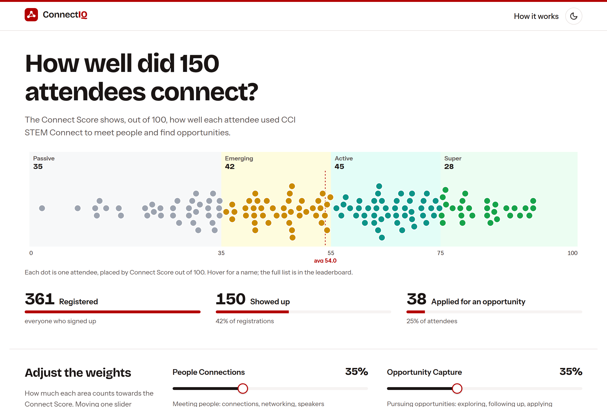
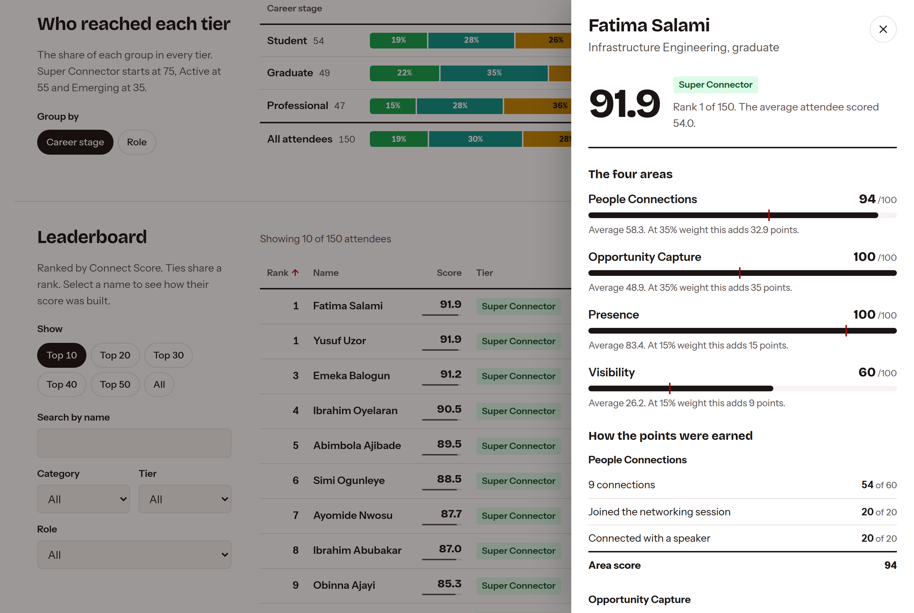
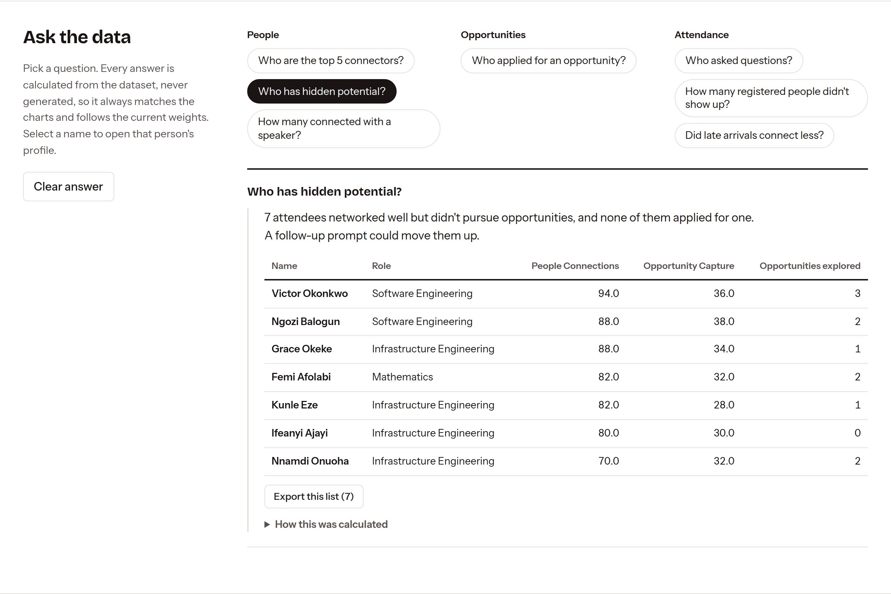
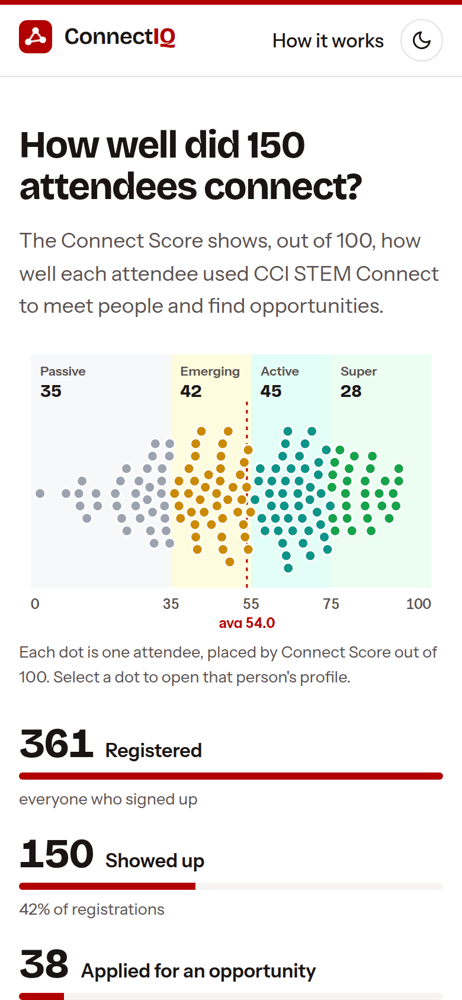

# ConnectIQ

**How well did each attendee of CCI STEM Connect meet people and find opportunities?**

ConnectIQ scores every attendee of [CCI STEM Connect](https://ikeja.joincci.org/) (Celebration Church International's STEM community event, 22 November 2026) out of 100, places them in a tier, and shows the organisers what drove the results and who to follow up with.

- **Repository:** https://github.com/youngancient/connectiq
- **Author:** [Jude](https://judetochy.vercel.app/)
- **How it works (in the app):** `/about`



> **The data is synthetic.** The registration total (361) is real, taken from the event's Luma page. The event's attendee data wasn't available, so attendance (150) and everything attendees did is simulated, with fictional names, to show how the model works.

---

## What it does

| Feature | What an organiser gets |
|---|---|
| **The room** | All attendees on one chart, placed by score and coloured by tier, with the average marked. Select a dot to open that person's profile. |
| **Key findings** | Plain-English statements with the number behind them, such as *"Attendees who joined networking made 4.4 more connections on average"*. A finding only appears when the difference is large enough to matter. |
| **Attendee profile** | Score, rank and tier, how each area compares with the average attendee, and every line of points earned or missed. |
| **Adjustable weights** | One slider per area. The others rebalance so the total stays at 100%, and every score, rank and finding updates live. The leaderboard marks rank changes (▲▼) against the defaults. |
| **Ask the data** | Seven preset questions (top connectors, hidden potential, who applied, who asked questions, no-shows…). Every answer is calculated, never generated. |
| **Export** | CSV of the leaderboard (choose Top 10…All, respecting filters), of any Ask-the-data list, or of the full results. Opens cleanly in Excel and Google Sheets. |
| **Comparisons** | Tier mix by career stage and role, arrival time and networking effects, and area averages by role, career stage and breakout track. |

| Profile | Ask the data | Mobile |
|---|---|---|
|  |  |  |

## How the score works

Each attendee earns points in four areas, each out of 100:

| Area | Default weight | Points |
|---|---|---|
| People Connections | 35% | connections made (capped at 10) up to 60, +20 for joining networking, +20 for connecting with a speaker |
| Opportunity Capture | 35% | opportunities explored (capped at 4) up to 40, follow-ups within a week (capped at 5) up to 30, +30 for applying |
| Presence | 15% | punctuality up to 40 (full marks by the 2:30pm keynote, nothing from 3:45pm), sessions attended (of 4) up to 60 |
| Visibility | 15% | questions asked (capped at 2) up to 40, +30 for joining the CCI STEM community, +30 for posting on LinkedIn |

**Connect Score** = the weighted sum. **Tiers:** Super Connector ≥ 75, Active ≥ 55, Emerging ≥ 35, otherwise Passive Attendee. Ties share a rank (1, 1, 3). Each area and the final score are rounded to one decimal place, the way the spreadsheet rounds.

It is a **weighted scorecard, not machine learning**: there are no outcomes to train on yet, and every point has to be explainable. Only people who checked in are scored; no-shows count towards the show-up rate only.

## Getting started

Requires Node 22.12 or later (Vitest and Vite need it).

```bash
npm install
npm run dev        # http://localhost:5173
```

| Script | What it does |
|---|---|
| `npm run dev` | Start the dev server |
| `npm test` | Run all unit tests (Vitest) |
| `npm run data` | Validate the spreadsheet export and rebuild the bundled dataset |
| `npm run build` | `data` + type-check + production build into `dist/` |
| `npm run preview` | Serve the production build locally |
| `npm run lint` | Lint with oxlint |
| `npm run typecheck` | Type-check only |

## Data

The source of truth is the event spreadsheet (tabs: Attendees, Scores, Settings, Data Dictionary, Leaderboard). The repo holds an export of it:

```
data/cci-stem-connect-2026/
  attendees.csv         the Attendees tab, one row per registration
  event.json            event name, date, schedule and the model settings (weights, caps, tiers, times)
  expected-scores.csv   the spreadsheet's Scores tab, used only by tests
```

`npm run data` checks every row against a strict schema and writes `src/data/events/cci-stem-connect-2026.json`, which the app bundles. **A bad row stops the build** and names the line and field, for example:

```
✗ cci-stem-connect-2026: Line 14: "Checked In" must be Yes or No, got "Y"
```

**To update the data:** export the Attendees tab as CSV over `attendees.csv`, run `npm run data`, then `npm test`. If the scoring settings changed in the spreadsheet, update `event.json` and re-export the Scores tab as `expected-scores.csv`.

## Architecture

A static, client-side React app with no backend, no database and no external calls after load. The code is in three layers:

```
src/
  data/        load and validate (schema.ts, csv.ts, events.ts)
  engine/      pure functions, no React: scoring, analytics, findings, explanations,
               weight balancing, Ask-the-data answers, CSV export
  components/  UI sections; pages/BriefPage.tsx is the /about page
  state/       one context: current weights, scores, selected attendee, open question
  config/      site.ts holds copy, links and the finding thresholds
scripts/
  build-data.ts  spreadsheet export → validated JSON
```

The engine never imports React, so every number on screen comes from a tested function, and the charts, findings, Ask-the-data answers and exports all agree.

**Stack:** React 19, TypeScript, Vite, Zod (validation), Vitest. Charts are hand-built SVG/HTML rather than a chart library, to keep the bundle small and the design consistent. Fonts are self-hosted, so there are no third-party requests.

## Testing

```bash
npm test
```

200+ unit tests, including:

- **All 150 scores match the spreadsheet.** Every area score, Connect Score and tier is compared with the spreadsheet's own Scores tab.
- Reference values (CCI-002 scores 67.8; joint rank 1 at 91.9; tier counts 28 / 45 / 42 / 35).
- Boundaries: punctuality limits, tier cut-offs, caps, rounding, ties, an event with no check-ins.
- Weight sliders always total 100% and don't drift over many steps.
- Each Ask-the-data answer, and that its lists match the findings.
- CSV export: quoting, Excel compatibility, and rows matching what the dashboard shows.

## Deployment

Deploys as a static site on Vercel (framework preset: Vite, build command `npm run build`, output `dist`). `vercel.json` rewrites `/about` (and the older `/brief`) to the app so those pages work when opened directly.

## Decisions and trade-offs

- **Scorecard, not ML.** No outcome data exists to train on, and organisers need to explain any score to the person who got it.
- **Data bundled in the repo, not fetched live.** The event is over and the data doesn't change; a static site is fast, cheap and has nothing to go down. All data access goes through `loadEvent()`, so moving to an API later changes one file.
- **No AI for Ask the data.** Answers are calculated in code, so they can't invent a number and always match the charts.
- **Findings only when they matter.** A finding needs a gap of at least 5 points (or 1 connection) and groups of at least 5 people; smaller differences are worded as "slightly" or left out. Thresholds live in `src/config/site.ts`.
- **Mobile-specific layout** is kept in one clearly marked block in `src/index.css`, so desktop is unaffected by phone tweaks.

## Limitations

- The attendee data is synthetic, so findings show how the model works, not what happened at the event.
- Scores haven't been checked against real outcomes (jobs, mentors, collaborations); a high score means strong engagement, not proven benefit.
- Some behaviour counts twice by design: joining networking adds to People Connections and to sessions under Presence; arriving late lowers punctuality and usually costs a session.
- The whole dataset ships to the browser. That is fine for fictional data; real attendee data would need a login or a backend that serves only aggregates.
- One event at a time; a new edition's data is added by rebuilding, not uploaded in the app.

## Next version

- **Upload each edition's spreadsheet** from the dashboard, checked and scored in the browser.
- **Compare editions** side by side, scored with the same weights, to see whether programme changes moved the results.
